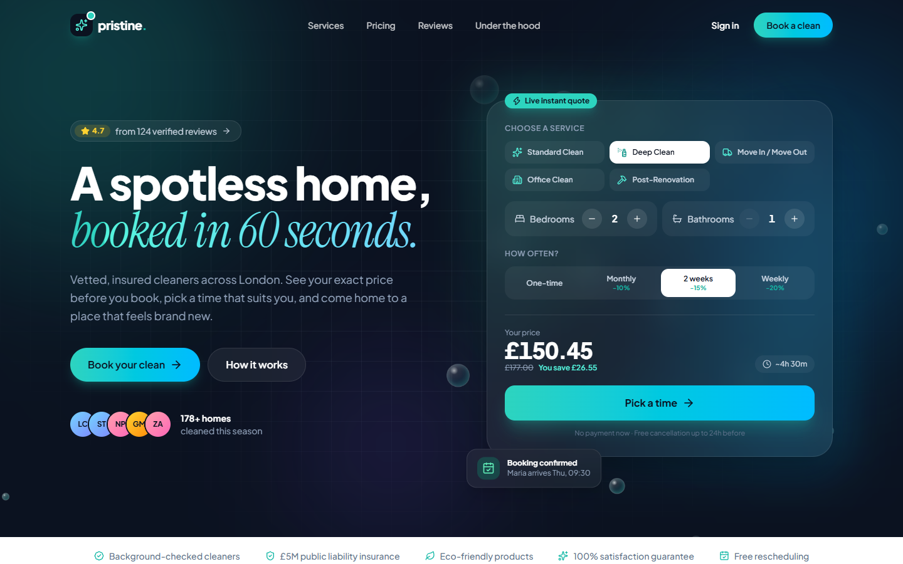
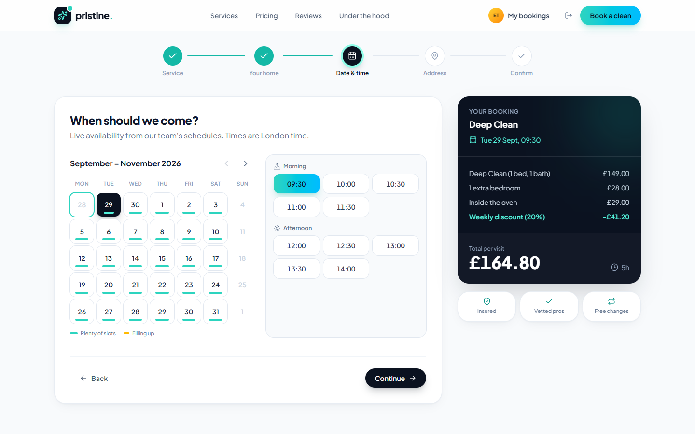
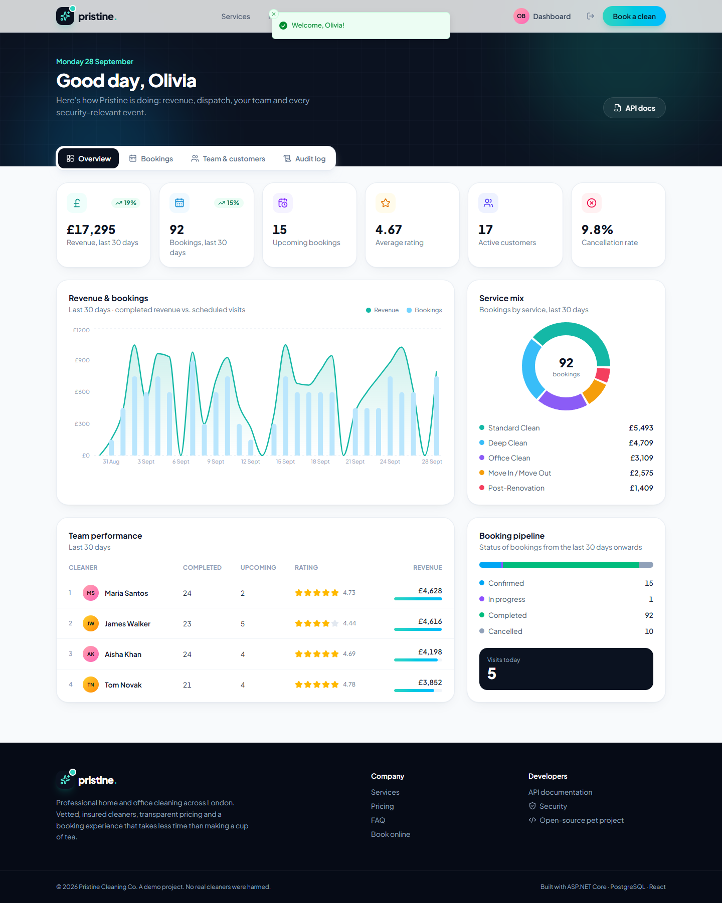
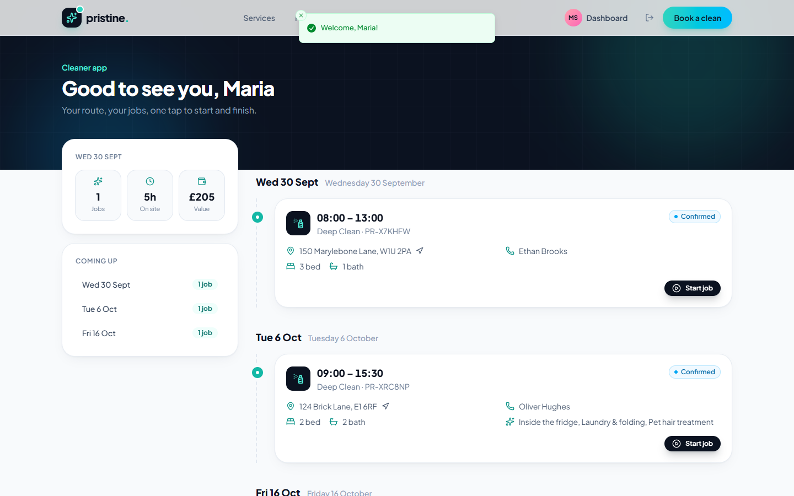
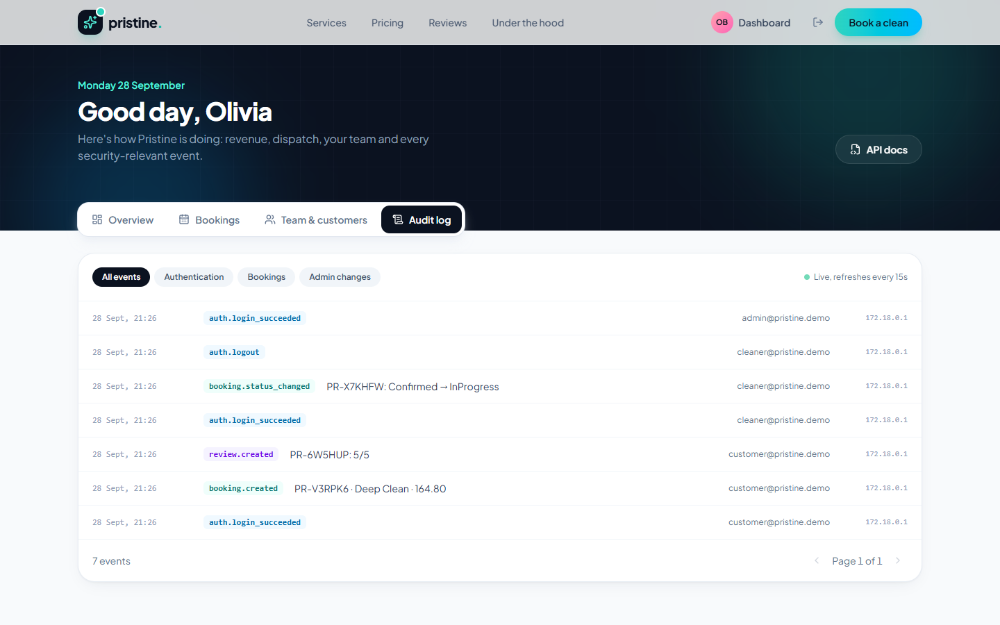

# Pristine: cleaning company booking platform

A full-stack booking system for a residential & commercial cleaning company, built as a portfolio project with a
**security-first backend**.

Customers get an instant price, pick a live time slot and manage their visits. Cleaners get a daily route with
one-tap job updates. Admins get revenue analytics, dispatch, user management and a security audit trail.



| Booking wizard | Admin analytics |
|---|---|
|  |  |
| **Cleaner app** | **Security audit log** |
|  |  |

| | |
|---|---|
| **Backend** | ASP.NET Core 10 Web API · EF Core 10 · PostgreSQL 17 |
| **Security** | JWT + rotating refresh tokens · BCrypt · RBAC + row-level scoping · rate limiting · audit log |
| **Docs** | Swagger / OpenAPI with XML comments and JWT "Authorize" |
| **Frontend** | React 19 · TypeScript · Vite · Tailwind CSS 4 · TanStack Query · Motion · Recharts |
| **Quality** | 28 integration & unit tests (xUnit + WebApplicationFactory) |
| **Ops** | Docker Compose (Postgres + API + nginx), non-root containers, health checks |

---

## Quick start

### Option A: everything in Docker (one command)

```bash
cp .env.example .env        # then put a long random JWT_SIGNING_KEY in .env
docker compose up --build
```

| URL | What |
|---|---|
| http://localhost:8080 | Web app |
| http://localhost:8080/swagger | API docs (proxied) |

### Option B: local development

```bash
docker compose up -d db                                   # PostgreSQL on localhost:5433
dotnet run --project backend/src/Pristine.Api --launch-profile http   # API on :5080, migrates + seeds
npm --prefix frontend install && npm --prefix frontend run dev        # Web on :5173 (proxies /api)
```

### Demo accounts

All demo accounts use the password `Demo#Pass2026`. The login page also has one-click buttons.

| Role | Email | What to try |
|---|---|---|
| Customer | `customer@pristine.demo` | Book, reschedule, cancel, leave a review |
| Cleaner | `cleaner@pristine.demo` | Daily route, start and complete jobs |
| Admin | `admin@pristine.demo` | KPIs & charts, dispatch, roles, audit log |

The seeder generates about two months of realistic history (200+ bookings, 100+ reviews) relative to today, so the
dashboards are never empty.

### Tests

```bash
dotnet test backend
```

The tests boot the real API in memory against an isolated SQLite database, so no Docker is needed.

---

## Security by design

| Threat | Mitigation | Where |
|---|---|---|
| Stolen tokens / XSS | Access token (15 min) is kept **in memory only**. The refresh token is an `HttpOnly; Secure; SameSite=Strict` cookie scoped to `/api/auth` | `AuthController`, `lib/api.ts` |
| Refresh-token theft | Tokens are **rotated** on every use and stored as **SHA-256 hashes**. Replaying a rotated token revokes the whole token family | `AuthService.RefreshAsync` |
| Brute force / credential stuffing | Per-IP rate limit on auth endpoints, **account lockout** after 5 failures for 15 min | `ServiceCollectionExtensions`, `AuthService` |
| User enumeration | One generic error message, and **constant-time login** (a dummy BCrypt verify runs for unknown emails) | `BCryptPasswordHasher.SimulateVerify` |
| Weak passwords | 10+ chars, upper/lower/digit/symbol, must not contain the email; BCrypt work factor 12 | `RegisterRequestValidator` |
| Privilege escalation / mass assignment | Role is never read from the request. Admin-only endpoints use policies; admins can't demote themselves; role changes **revoke all sessions** | `AuthService.RegisterAsync`, `AdminService` |
| IDOR | Every booking query starts from a **role-scoped `IQueryable`**, so another user's booking is indistinguishable from a missing one (404) | `BookingService.Scoped` |
| Price tampering | The client never sends a price; every booking is **re-priced on the server** | `PricingService` |
| Race conditions / double booking | Slot allocation runs in a **Serializable transaction**; updates use an optimistic concurrency token | `BookingService.CreateAsync` |
| SQL injection | EF Core LINQ only, fully parameterised. Covered by a test | `BookingTests` |
| JWT forgery / `alg: none` | Issuer, audience, lifetime and signature validated; only `HS256` accepted. The dev key is rejected outside Development | `AddSecurity` |
| Information leakage | RFC 9457 ProblemDetails with a trace id and no stack traces; JSON parser errors don't echo type names; `Server` header removed | `GlobalExceptionHandler` |
| Clickjacking, MIME sniffing & co. | CSP, `X-Frame-Options: DENY`, `nosniff`, `Referrer-Policy`, `Permissions-Policy`, COOP/CORP, HSTS | `SecurityHeadersMiddleware`, `nginx.conf` |
| Oversized payloads | Kestrel request body limited to 64 KB | `Program.cs` |
| Forensics | **Audit log** of logins, failures, lockouts, token reuse, bookings and admin changes (user, IP, timestamp) | `AuditService` |
| Privacy | Public reviews show only first name + initial; customers never see cleaners' contact details | `ReviewService`, `BookingService.ToDto` |

---

## API overview

| Method | Endpoint | Access |
|---|---|---|
| POST | `/api/auth/register` · `/login` · `/refresh` · `/logout` | Public (rate limited) |
| GET | `/api/auth/me` | Authenticated |
| GET | `/api/services` · `/api/services/{slug}` · `/api/extras` | Public |
| POST/PUT/DELETE | `/api/services` | Admin |
| POST | `/api/quotes` | Public |
| GET | `/api/availability?date=&durationMinutes=` · `/api/availability/calendar` | Public |
| POST | `/api/bookings` | Customer |
| GET | `/api/bookings` · `/api/bookings/{id}` | Scoped by role |
| POST | `/api/bookings/{id}/cancel` · `/reschedule` | Owner (24h rule) / Admin |
| PATCH | `/api/bookings/{id}/status` | Assigned cleaner / Admin (state machine) |
| PUT | `/api/bookings/{id}/cleaner` | Admin |
| POST | `/api/bookings/{id}/review` | Owner, once, after completion |
| GET | `/api/reviews` · `/api/reviews/summary` | Public |
| GET/PUT/POST | `/api/admin/dashboard` · `/users` · `/users/{id}` · `/users/{id}/unlock` · `/cleaners` · `/audit-logs` | Admin |
| GET | `/health` | Public |

Full, interactive documentation is available in Swagger.

### Booking lifecycle

```
Pending ──(admin assigns cleaner)──► Confirmed ──► InProgress ──► Completed ──► (review)
   └───────────────┬────────────────────┘
                   └──► Cancelled   (customer: ≥24h before · admin: any time)
```

### Business rules

- Opening hours 08:00–19:00 London time, Monday to Saturday, 30-minute slots
- At least 12 hours' notice, up to 60 days ahead, 30-minute travel buffer between a cleaner's jobs
- The least-busy free cleaner is auto-assigned; rescheduling keeps the same cleaner when possible
- Recurring discounts: monthly −10%, every 2 weeks −15%, weekly −20%

---

## Project structure

```
backend/
  src/Pristine.Api/
    Controllers/        thin HTTP layer + Swagger annotations
    Features/           Auth, Bookings, Pricing, Scheduling, Catalog, Reviews, Admin, Audit
    Domain/             entities & enums
    Data/               DbContext, migrations, demo seeder
    Security/           JWT, BCrypt, security headers, policies
    Common/             ProblemDetails handler, validation filter, paging
  tests/Pristine.Api.Tests/   auth, IDOR, JWT forgery, SQLi, double-booking, pricing
frontend/
  src/pages/            Landing, BookingWizard, Customer/Cleaner/Admin dashboards
  src/components/       UI kit, live quote widget, slot picker
  src/lib/              API client (single-flight token refresh), auth context
docker-compose.yml
```

## Switching to MS SQL Server

Data access goes through EF Core, and the model uses no provider-specific types. To target SQL Server, add
`Microsoft.EntityFrameworkCore.SqlServer`, add a `SqlServer` branch next to `UseNpgsql` in `AddPersistence`, and
generate a migration for that provider.
